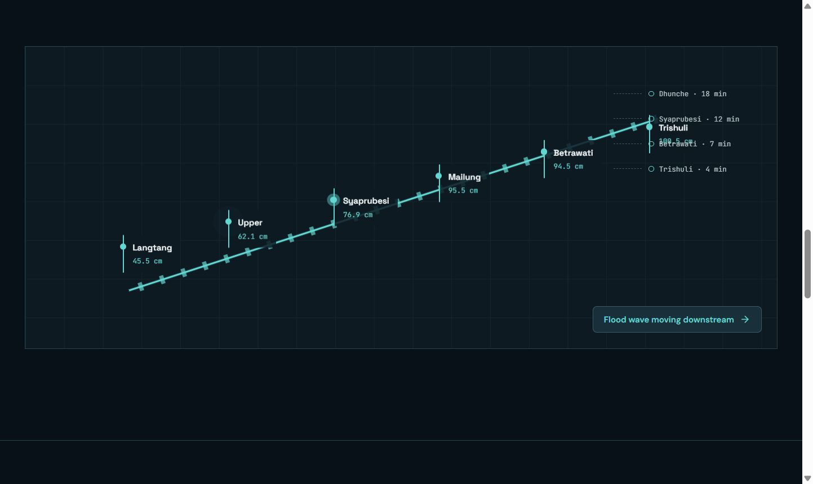
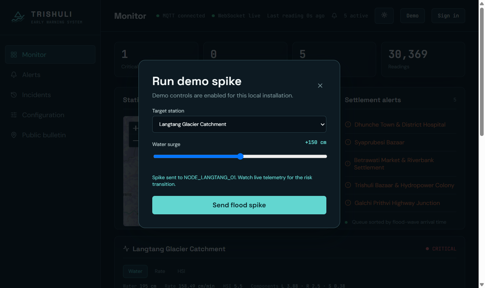
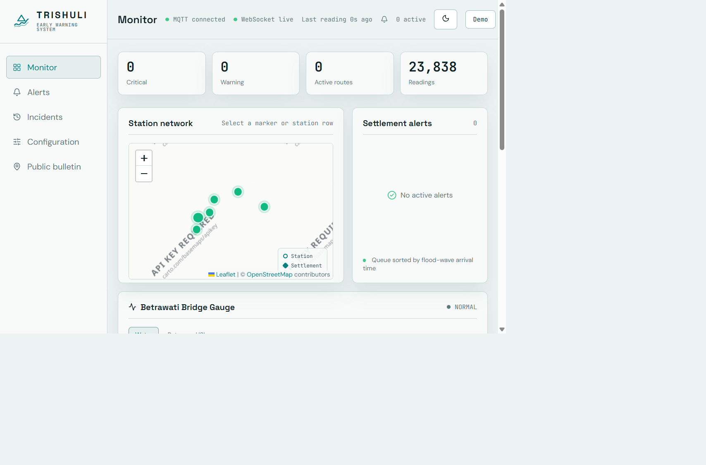
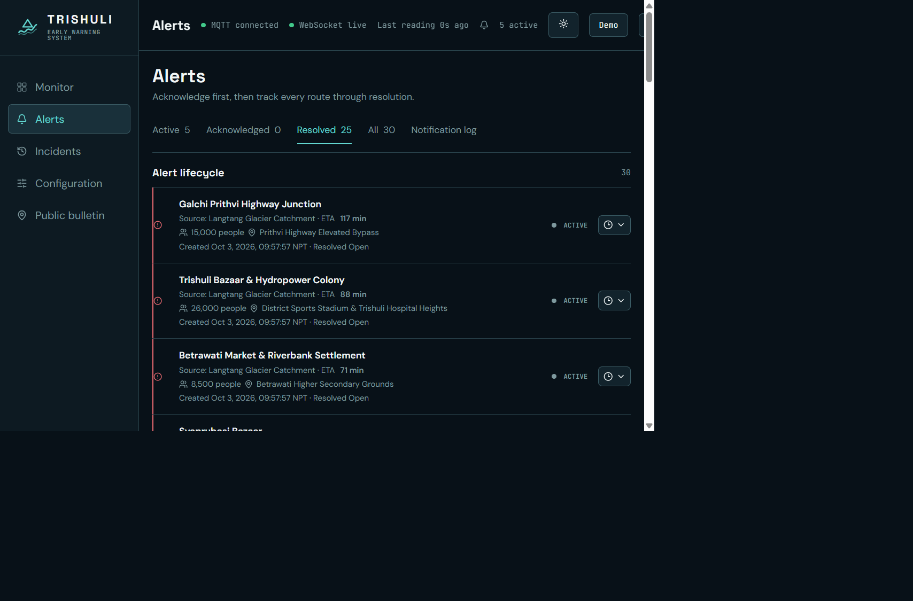
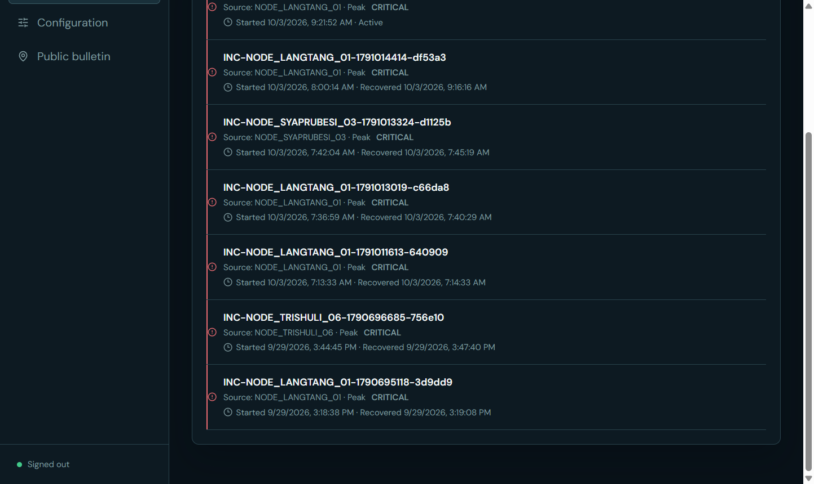
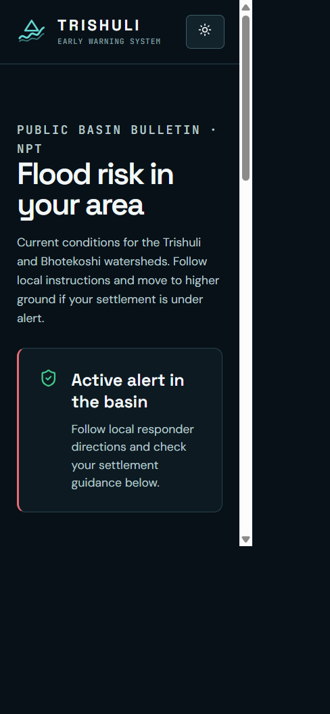
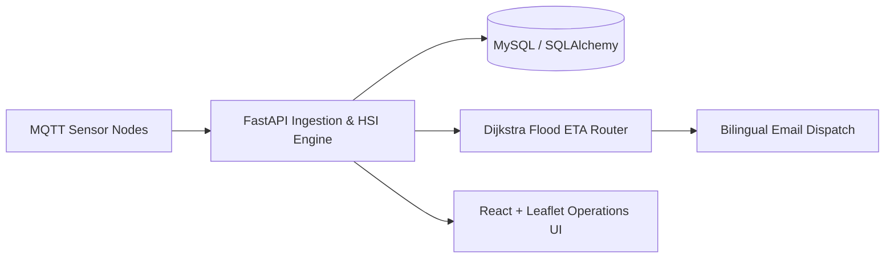

 

 

**[Overview](#overview) · [Features](#features) · [Architecture](#architecture) · [Connect](#connect)**

---

## Overview

**Himdhara (हिमधारा)** is an autonomous, real-time river surveillance and downstream hazard dispatch platform engineered for Nepal's Himalayan river basins (Trishuli, Bagmati, Koshi, Gandaki, and Karnali).

  

---

## Features

<table>
<tr>
<td width="50%" valign="top">

### Telemetry & Physics Engine
- **IoT MQTT Emulation**: 5-second sensor feeds (water level, rainfall, soil moisture)
- **Hydrological Stress Index (HSI)**: EMA + flash surge rate (`dWL/dt`) + soil saturation
- **Multi-tier Risk**: `NORMAL` → `WATCH` → `WARNING` → `CRITICAL`

</td>
<td width="50%" valign="top">

### Routing & Dispatch
- **Dijkstra Flood ETA**: calculates exact flood wave arrival times for downstream settlements
- **Bilingual Alerts**: automated HTML/text email dispatch in **Nepali (नेपाली)** and **English**
- **Operations Center**: dark/light GIS dashboard with one-click flood surge simulation

</td>
</tr>
</table>

### System Interface

| Operations Center (Dark) | Operations Center (Light) |
| :---: | :---: |
|  |  |

| Critical Flood Incident | Incident Timeline Log |
| :---: | :---: |
|  |  |

| Public Web Bulletin | Mobile Responsive View |
| :---: | :---: |
|  |  |

---

## Architecture

---

## Connect

