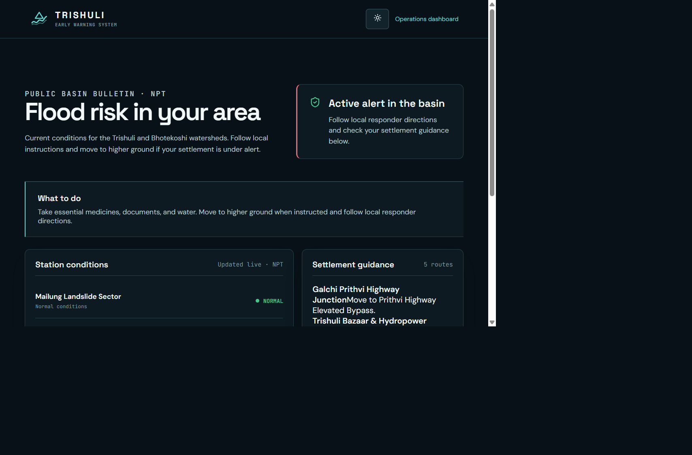
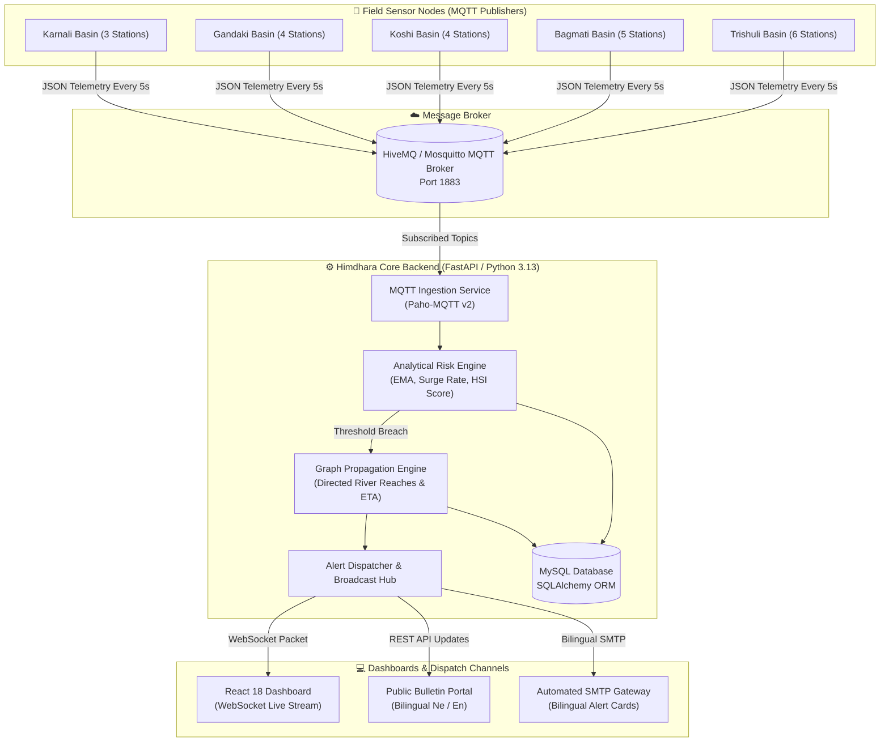

<div align="center">

# 🌊 हिमधारा (Himdhara)
### Autonomous Multi-Basin River Early Warning & Downstream Hazard Dispatch System for Nepal

[](https://fastapi.tiangolo.com)
[](https://react.dev)
[](https://leafletjs.com)
[](https://mqtt.org)
[](https://www.mysql.com)
[](#)

<p align="center">
  <b>A real-time, distributed hydrological telemetry, graph-based downstream flood wave routing, and automated multi-lingual emergency dispatch platform engineered for Himalayan river basins.</b>
</p>

[System Overview](#-system-overview) •
[Interactive Architecture](#-interactive-architecture) •
[Screenshots & UI Tour](#-system-interface--visual-tour) •
[Key Features](#-key-features) •
[Hydrodynamic Model](#-hydrodynamic-stress-model-hsi) •
[Quick Start](#-quick-start-guide) •
[Demonstration Workflow](#-evaluator-demo--viva-guide)

---

</div>

<p align="center">
  
</p>

---

## 🌟 System Overview

**Himdhara** is an automated, real-time river surveillance and disaster risk reduction framework built for Nepal's steep topography and flash-flood vulnerable river valleys:

1. **IoT Telemetry Emulation (MQTT)**: Continuous 5-second asynchronous sensor feeds streaming water level (cm), precipitation intensity (mm), and soil moisture content (%) across **5 major Nepalese river basins** (Trishuli, Bagmati, Koshi, Gandaki, and Karnali).
2. **Dynamic Hydrological Stress Index (HSI)**: A calibrated physics-grounded engine combining Exponential Moving Averages (EMA), flash surge rates of change ($\frac{dWL}{dt}$), and soil saturation into a deterministic multi-tier risk classification (`NORMAL` $\to$ `WATCH` $\to$ `WARNING` $\to$ `CRITICAL`).
3. **Directed Graph Propagation (Dijkstra's ETA)**: Models river reaches as directed network edges with stream velocities and geodetic distances to calculate the precise flood wave **Estimated Time of Arrival (ETA)** in minutes for vulnerable downstream human settlements.
4. **Bilingual Emergency Email Dispatch**: Automatically compiles and delivers high-priority, formatted HTML/plain-text alert notices to local disaster management authorities and registered residents in both **Nepali (नेपाली)** and **English**.
5. **Interactive Operations Dashboard**: High-performance React operations suite featuring real-time GIS river vector overlays, live telemetry graphs, interactive 3D terrain projections, and one-click demo flood surge injection.

---

## 📸 System Interface & Visual Tour

### 1. Operations Center — Live Basin Surveillance
Real-time geographic tracking of river gauge nodes with topological edge flow and dynamic risk color-coding.

| Dark Theme (Night Operations) | Light Theme (Field Monitoring) |
| :---: | :---: |
|  |  |

---

### 2. Downstream Incident Dispatch & Lifecycle Management
State machine tracking of alerts (`ACTIVE` $\to$ `ACKNOWLEDGED` $\to$ `RESOLVED`), flood surge propagation paths, and real-time operator triage.

| Critical Flood Incident View | Incident Timeline Log |
| :---: | :---: |
|  |  |

---

### 3. Public Early Warning Bulletin (Civic Portal)
Zero-friction, mobile-optimized public portal allowing riverside residents to check live basin safety status and self-register for automated email hazard warnings.

| Public Web Bulletin | Mobile Responsive View |
| :---: | :---: |
|  |  |

---

## 📐 Interactive Architecture



---

## 🔬 Hydrodynamic Stress Model (HSI)

Himdhara does not rely on static water level triggers alone; it computes a composite **Hydrological Stress Index ($HSI$)** synthesizing three critical hydraulic terms:

$$HSI = S_{\text{level}} + 0.5 \cdot S_{\text{rate}} + S_{\text{soil}}$$

### Component Terms:
1. **Stage Stress ($S_{\text{level}}$)**: Continuous piecewise normalization measuring depth relative to calibrated bankfull safety thresholds:
   - $S_{\text{level}} \ge 3.0$: Water level exceeds **Critical Bankfull Capacity**.
   - $2.0 \le S_{\text{level}} < 3.0$: Water level is within the **Warning Zone**.
   - $1.0 \le S_{\text{level}} < 2.0$: Water level is approaching **Watch Level**.
2. **Surge Acceleration Term ($S_{\text{rate}}$)**: Captures dangerous upstream cloudburst torrents and glacial outbursts:
   $$S_{\text{rate}} = \min\left(2.5, \; \frac{1}{\Delta t} \cdot \frac{WL_t - WL_{t-1}}{12.0}\right)$$
3. **Soil Moisture Saturation Term ($S_{\text{soil}}$)**: Accounts for catchment runoff coefficient reduction due to saturated soil:
   $$S_{\text{soil}} = \max\left(0.0, \; \frac{\text{Moisture}\% - 70.0}{30.0}\right)$$

### Downstream Flood Travel ETA:
The propagation engine treats every river basin as a directed acyclic graph $G = (V, E)$, computing the shortest downstream path to vulnerable settlements using cumulative reach travel times:

$$\text{ETA}_{\text{settlement}} = \sum_{e \in \text{Path}} \frac{\text{Distance}_e}{v_e}$$

---

## ⚡ Key Features

| Capability | Technical Implementation | Benefit |
| :--- | :--- | :--- |
| **Multi-Basin Surveillance** | 5 distinct river basins (`shared/basins/*.json`) | Nationwide multi-valley scalability |
| **Instant Real-Time Stream** | Full-duplex WebSocket (`/ws/stream`) | Sub-100ms dashboard latency without polling |
| **Graph-Based Routing** | Dijkstra shortest-path downstream reach model | Accurate warning evacuation lead times |
| **Bilingual Dispatch** | Modern HTML + fallback plain text in EN & नेपाली | Critical clarity for grassroots rural communities |
| **Deduplicated Delivery** | Unique alert ID state machine tracking | Zero duplicate notification spamming |
| **Field Stale Detection** | Automatic heartbeat watchdog (`STALE_AFTER_SECONDS`) | Prevents silent sensor failure oversights |
| **RBAC Security** | JWT Authentication with Operator role enforcement | Protected configuration & incident audit trail |

---

## 🚀 Quick Start Guide

### Prerequisites
- **Python 3.11+** installed
- **Node.js 18+ & npm** installed
- **MySQL Server** (XAMPP / MySQL Workbench / Docker) running locally

---

### Step 1: Clone & Configure

```powershell
# Clone the repository
git clone https://github.com/itsniranjannn/Himdhara.git
cd Himdhara

# Create and configure .env
cp .env.example .env
```

Ensure your `.env` contains:
```env
DATABASE_URL=mysql+pymysql://root:@localhost:3306/floodalert
JWT_SECRET=your_super_secret_jwt_key
DEFAULT_OPERATOR_USERNAME=operator
DEFAULT_OPERATOR_PASSWORD=niranjan

# Real email dispatch via Gmail SMTP
EMAIL_PROVIDER=smtp
SMTP_HOST=smtp.gmail.com
SMTP_PORT=587
SMTP_USERNAME=your_email@gmail.com
SMTP_PASSWORD=your_gmail_app_password
SMTP_FROM=your_email@gmail.com
SMTP_STARTTLS=true
```

---

### Step 2: One-Click Startup (All Services)

You can launch the **Backend**, **Sensor Simulator**, and **Frontend** simultaneously using the automated PowerShell script:

```powershell
.\start_all.ps1
```

Or start the components individually in separate terminals:

```powershell
# Terminal 1: Backend (FastAPI on Port 8000)
python backend\run.py

# Terminal 2: Sensor Network Simulator (MQTT Telemetry Publisher)
python -u sensor-sim\simulator.py

# Terminal 3: Operations Dashboard (Vite on Port 5173)
cd frontend
npm install
npm run dev
```

Visit **`http://localhost:5173`** to access the live dashboard!

---

## 🎯 Evaluator Demo / Viva Guide

### Demonstrating a Live Flash Flood During Presentation:
1. Open the operations dashboard at `http://localhost:5173/app/monitor`.
2. Click **Sign in** in the top navigation bar (`Username: operator`, `Password: niranjan`).
3. Switch the basin dropdown to **Bagmati** or **Gandaki**.
4. Click the **Demo** button in the header.
5. Select a target headwater station (e.g. `Sundarijal Headwater Gauge`), adjust the surge slider to `+150 cm`, and click **Send flood spike**.
6. **Watch the live cascade:**
   - A floating status pill confirms: *"Spike sent. Watch the station turn WARNING then CRITICAL within a few readings."*
   - Within 5–10 seconds, the station turns **CRITICAL (Red)** on both the map and telemetry charts.
   - Downstream settlements (e.g., *Gokarna Riverside Wards*, *Tilganga*, *Thapathali*) receive calculated flood arrival times (ETAs).
   - The system triggers an immediate **Bilingual HTML Emergency Email** delivered directly to registered settlement contacts.
   - Click **Reset simulation** in the Demo menu at any time to return all river basins to baseline.

---

## 👥 Contributors & Academic Credits

- **Project Lead & Developer**: Niranjan Katwal ([@itsniranjannn](https://github.com/itsniranjannn))
- **Program**: Bachelor of Computer / Software Engineering (8th Semester Final Project)
- **Institution**: Pokhara University / Tribhuvan University Affiliated Engineering College, Nepal

---

<div align="center">
  <sub>Built with ❤️ for disaster resilience, community safety, and river monitoring in Nepal.</sub>
</div>
